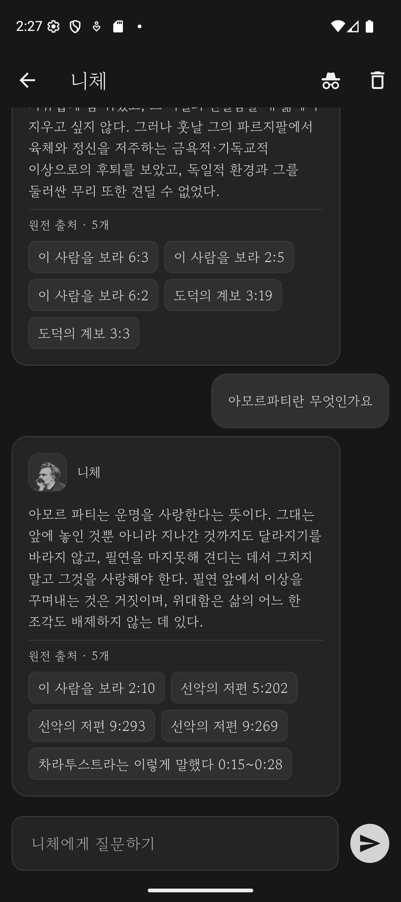
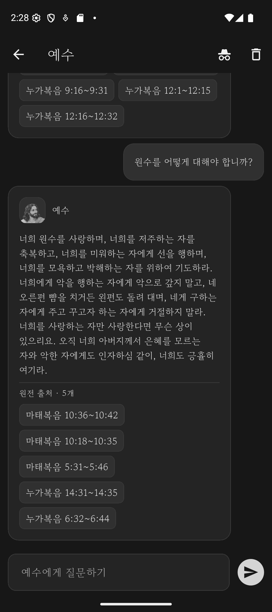
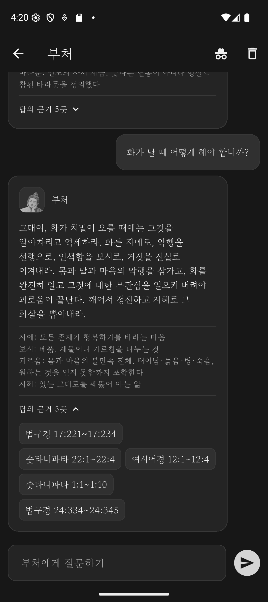
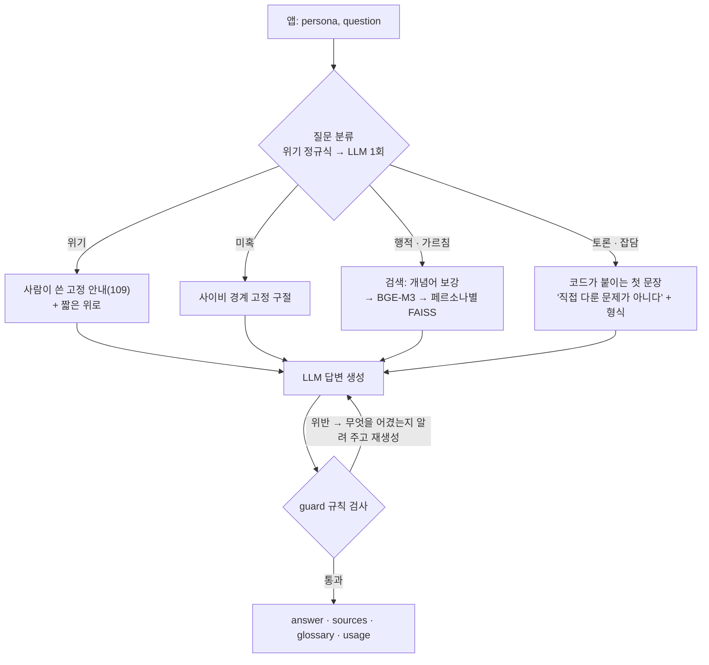

# 쉼표, — 철학자에게 묻는 RAG 챗봇

니체 · 예수 · 부처에게 고민을 물으면, 각자의 **원전에서 근거 구절을 찾아** 그 사람의 목소리로 한국어로 답하는 서비스입니다.
검색 · 질문 분류 · 프롬프트 조립 · LLM 호출 · 답변 규칙 검사를 하는 **FastAPI 백엔드**와 Flutter Android 앱으로 이루어져 있습니다.

<p>
  
  
  
</p>

화면 12장과 답변 평가 보고서는 [output/Portfolio](output/Portfolio/README.md)에 있습니다.

| | |
|---|---|
| **백엔드** | Python 3.11 · FastAPI · LangChain · BGE-M3 (sentence-transformers) · FAISS · SQLite · Firebase ID 토큰 검증 · pytest |
| **LLM** | OpenAI `gpt-5.6-luna` (추론 끔). `.env` 한 줄로 Gemini · Groq · OpenRouter · Ollama 로 교체 |
| **코퍼스** | 니체 6권 · 공관복음 3권 · 빠알리 경장 8종 — 영어 공개 번역본 약 48만 단어, 청크 1,878개 |
| **품질** | 31문항을 사람이 원전과 대조해 판정 — 통과 29 · 주의 2 · 실패 0 ([보고서](output/Portfolio/eval/report-2026-10-14.md)) |
| **비용 · 속도** | 질문 1개 약 $0.001, 응답 평균 5.7초 |
| **테스트** | 백엔드 72개 · 앱 53개 (가짜 LLM, API 호출 없음) |

## 요청 처리 흐름

앱은 `{persona, question}` 만 보냅니다. API 키 · 임베딩 모델 · 벡터 검색은 전부 서버에 있습니다
(APK 에 넣은 키는 공개된 것과 같고, 5억 파라미터 임베딩 모델과 FAISS 는 폰에서 돌릴 수 없어서입니다).



1. **분류** — 자살·자해 표현은 정규식이 호출 없이 먼저 잡습니다. 나머지는 LLM 한 번으로 여섯 갈래(위기 · 미혹 · 행적 · 가르침 · 토론 · 잡담)를 정합니다.
   분류마다 검색 여부, 프롬프트 형식, 온도가 다릅니다 ([`rag.py`](backend/app/rag.py))
2. **검색** — 한국어 질문을 그대로 BGE-M3 로 임베딩해 철학자별로 나뉜 FAISS 인덱스에서 찾습니다.
   "아모르파티"·"열반" 같은 음차·한자어는 검색어에만 원어를 덧붙입니다 ([`concepts.py`](backend/app/concepts.py))
3. **생성 · 검사** — 답이 페르소나 규칙(영어 혼입, 3인칭 자칭, 말투, 출처 표기, 길이 등)을 어기면 어긴 내용을 지적하며 다시 쓰게 합니다.
   검사기는 고치지 않고 지적만 합니다. 문장을 후처리로 바꾸면 근거와 어긋날 수 있어서입니다 ([`guard.py`](backend/app/guard.py))
4. **응답** — 근거 구절의 위치(작품명 한글 표기 + 장절)를 함께 돌려줍니다. 앱은 "답의 근거 5곳"으로 접어 보여 줍니다

<details>
<summary><code>POST /ask</code> 응답 예시 (실제 응답, 근거 구절 5개 중 2개만)</summary>

```json
{
  "persona": "nietzsche",
  "question": "아모르파티란 무엇인가요",
  "answer": "아모르파티란 운명을 사랑하는 일이다. 그대 앞에 놓인 것뿐 아니라 지나간 것까지도 달라지기를 바라지 않고, 필연을 단지 견디거나 숨기지 않으며 그것을 사랑하는 태도다. …",
  "grounded": true,
  "safety": false,
  "retries": 0,
  "glossary": [],
  "sources": [
    {"chunk_id": "nietzsche#296", "work": "ECCE HOMO", "work_ko": "이 사람을 보라", "ref": "2:10", "title": "Why I Am So Clever", "score": 0.4785},
    {"chunk_id": "nietzsche#116", "work": "BEYOND GOOD AND EVIL", "work_ko": "선악의 저편", "ref": "5:202", "title": "The Natural History of Morals", "score": 0.4331}
  ],
  "usage": {"plan": "pro", "plan_name": "Pro", "used_today": 51, "daily_limit": null}
}
```
</details>

| 엔드포인트 | 내용 |
|---|---|
| `POST /ask` | 질문 → 답 · 근거 위치 · 용어 풀이 · 사용량 |
| `GET /personas` · `GET /health` | 페르소나 목록 · 상태 |
| `GET /usage` | 오늘 사용량. 요금제(하루 5건 / 무제한)는 SQLite 로 세고, 동시 요청에도 한도를 넘지 않게 호출 전에 미리 올린 뒤 실패하면 돌려준다 |
| `POST /reports` · `GET /reports` | 대화 신고 저장 · 목록 (목록은 개발자 계정만) |
| `GET /me` | 사용자 ID · 개발자 여부. 로그인했으면 Firebase ID 토큰을 Google 공개키로 검증한 계정, 아니면 기기 ID |

## 설계 결정과 근거

| 결정 | 근거 |
|---|---|
| **청크 512 토큰, 짧은 단위는 묶고 긴 단위만 문장 경계에서 쪼갠다** | 단위의 91%가 128토큰 미만(차라투스트라·복음서)인데 2,000토큰이 넘는 절(도덕의 계보)도 있다. 질문 7개로 A/B — 512 MRR 0.619, 256 은 0.512 |
| **한국어 질문을 영어로 번역하지 않는다** | 코퍼스가 영어라 번역이 나을 줄 알았지만 같은 측정에서 512 영어 MRR 0.262 로 가장 나빴다. 대신 개념어만 원어를 덧붙인다 |
| **철학자마다 인덱스를 따로 둔다** | 니체 질문에 마태복음이 섞이는 것을 프롬프트가 아니라 구조로 막는다 |
| **니체는 본인이 출간한 글만, 역자 해설·유고는 뺀다** | 페르소나가 남이 쓴 문장이나 본인이 철회한 주장을 자기 말로 하지 않게. 해설을 1인칭으로 바꿔 넣는 것은 근거 조작이다 |
| **답할 질문인지는 점수가 아니라 분류가 정한다** | 유사도 기준선 0.45 에서 예수의 「바람직한 삶」(0.448)이 근거 없음으로 떨어졌다. 「점심 메뉴」는 0.442 — 점수로는 가를 수 없다 |
| **위기 안내 문구는 모델이 아니라 코드가 붙인다** | 소형 모델은 "자살을 말하면 109 를 안내하라" 같은 조건 규칙을 지키지 못했다. 고정 문구는 사람이 쓰고, 위기면 검색도 하지 않는다 |
| **추론을 끈다 (`reasoning_effort=none`)** | 기본값이면 보이지 않는 추론 토큰이 출력 요금으로 청구된다. 끈 뒤 추론 토큰 0 을 확인했고 질문당 약 $0.001 |

## 문제 해결 사례

**근거가 없을 때 지어낸 말을 철학자의 말처럼 했다.**
「주식 투자는 어떻게 시작해야 합니까?」에 니체가 코퍼스에 없는 책의 말을 들며 "운명에 맞서라"고 했는데, 이는 니체의 amor fati(이 사람을 보라 2:10)와 정반대다.
원인은 "근거가 없으면 네가 한 말 중 가장 가까운 것을 말하라"는 프롬프트였다 — RAG 의 근거 보장은 검색된 구절에만 미치고, 그 밖은 모델의 기억이다.
지금은 근거 없는 답이 코드가 붙이는 첫 문장("이것은 내가 책에서 다룬 문제가 아니다")으로 시작해, 듣는 사람이 추론임을 알 수 있다.

**자동 지표가 만점인데 답이 틀렸다.**
"정답 구절에만 있는 표현이 답에 나오는 비율"로 채점했더니 두 답이 만점이었다. 원문과 대조하니 둘 다 논지를 뒤집고 있었다 —
니체가 "거짓"이라 고발한 사제의 처방을 니체의 조언으로, 과부의 "가진 생활비 전부"를 "작은 일을 하라"로.
지표를 버리고 **논지 일치 · 인용 적합성 · 발화자 정합** 세 기준으로 사람이 판정하는 평가 세트를 만들었다.

**음차 개념어는 다국어 임베딩도 못 잇는다.**
「아모르파티란 무엇인가요」에서 amor fati 구절이 26위라 니체가 "책에서 다룬 문제가 아니다"라고 답했다. 검색어에만 "(amor fati)"를 덧붙이자 1위가 됐다.
사전의 54개 항목은 모두 순위가 오르는 것을 재고 넣었다 (열반 7 → 1, 팔복 30위 밖 → 1). 문장 전체 번역은 측정상 나빴으므로 개념어만 붙인다.

**평가에서 실패 3건 → 고친 뒤 0건.**
첫 측정에서 「돈 걱정으로 잠이 안 옵니다」가 위기로 분류돼 상담전화 안내가 나갔고, 예수가 근거로 답하면서 "가르친 바가 아니니라"로 시작해 근거 없음으로 표시됐다.
위기 기준을 "자기 생명에 관한 말"로 좁히고, 질문 종류를 분류 호출이 정하게 바꾼 뒤 31문항을 다시 재 실패 0 이 됐다 ([보고서](output/Portfolio/eval/report-2026-10-14.md)).

## 구조

```
backend/
├─ app/
│  ├─ main.py        FastAPI 엔드포인트
│  ├─ rag.py         분류 → 검색 → 프롬프트 → LLM → 검사 → 재생성
│  ├─ personas.py    페르소나 정의와 시스템 프롬프트
│  ├─ retriever.py   BGE-M3 + FAISS 검색 (서버 기동 때 모델을 미리 올린다)
│  ├─ concepts.py    개념어 사전 (검색어 보강)
│  ├─ guard.py       답변 규칙 검사
│  ├─ llm.py         LLM 프로바이더 팩토리
│  ├─ plans.py · auth.py · reports.py   사용량 한도 · 토큰 검증 · 신고 (SQLite)
│  └─ glossary.py · works.py            용어 풀이 · 작품명 한글 표기 (고정 표)
├─ tests/            pytest 72개 — LLM 을 가짜로 바꿔 경로·검사·한도를 시험한다
└─ data/corpus/      원전 .txt + 구절 단위 .jsonl
scripts/             코퍼스·인덱스 빌드, 검색 A/B, 답변 평가
mobile/              Flutter 앱 (Android)
output/Portfolio/    화면 캡처 · 평가 보고서
CLAUDE.md            설계 결정과 작업 규칙 (개발 기록)
```

## 실행

```bash
# 1. 환경 (conda, Python 3.11)
conda create -n philo-rag python=3.11
conda activate philo-rag
pip install torch --index-url https://download.pytorch.org/whl/cu128   # GPU 가 없으면 .../whl/cpu
pip install -r backend/requirements.txt

# 2. 설정 — backend/.env 에 LLM 키를 넣는다 (GPU 가 없으면 EMBEDDING_DEVICE=cpu, EMBEDDING_DTYPE=float32)
copy backend\.env.example backend\.env

# 3. 인덱스 (gitignore 라 처음 한 번 만든다)
python scripts/build_index.py

# 4. 서버 — http://localhost:8000/chat 에서 브라우저로 대화, /docs 에 API 문서
cd backend
python -m uvicorn app.main:app --host 0.0.0.0 --port 8000

# 테스트 (API 호출 없음)
python -m pytest tests -q
```

앱은 `mobile/` 에서 `flutter run`. Android 에뮬레이터에서 PC 의 서버는 `http://10.0.2.2:8000` 입니다.

## 데이터 출처

- 니체 6권 · KJV 공관복음 — [Project Gutenberg](https://www.gutenberg.org/) 퍼블릭 도메인 영역본
- 빠알리 경장 8종 — [SuttaCentral](https://suttacentral.net/) Bhikkhu Sujato 영역 (CC0 1.0)
- 앱 글꼴 고운바탕 — SIL Open Font License (`mobile/assets/fonts/OFL-GowunBatang.txt`)

수록 · 제외 기준(역자 해설 · 유고 · 중복 제외)과 작품별 제외 내역은 [CLAUDE.md](CLAUDE.md) 3절에 있습니다.
